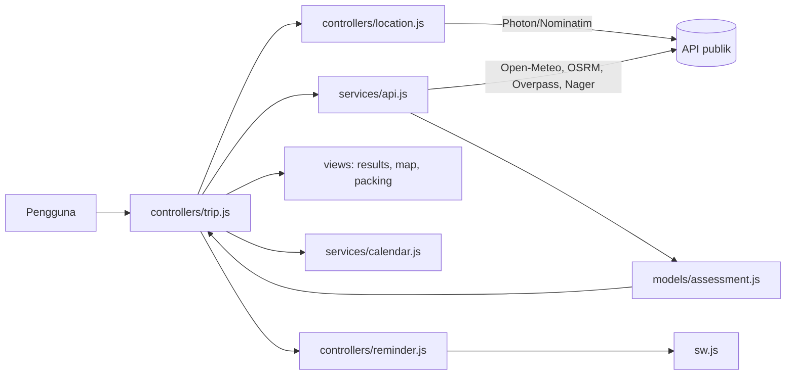
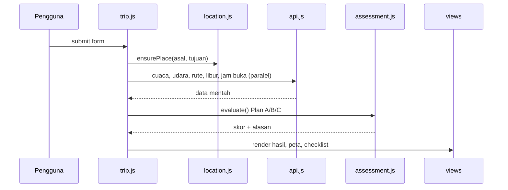

# Arsitektur TripReady

Aplikasi *client-side* murni, tanpa database. Karena itu tidak ada ERD fisik; yang ada adalah [ERD konseptual](ERD.md) dan diagram alur data di bawah.

## Lapisan kode (`js/`)
| Lapisan | Tanggung jawab | Berkas |
|---|---|---|
| core | Konstanta, helper, state sesi `S` | `core/core.js` |
| models | Logika murni tanpa DOM/HTTP (skor risiko, parser jam buka, checklist) | `models/*.js` |
| services | Komunikasi eksternal (API, kalender, notifikasi) | `services/*.js` |
| views | Menulis ke DOM | `views/*.js` |
| controllers | Menangani event & mengorkestrasi alur | `controllers/*.js` |

## Alur data

## Alur "Lihat Rekomendasi" (`runPlan`)

## Skor risiko (`models/assessment.js`)
`assess()` menjumlahkan poin dari peluang hujan, jenis cuaca, panas, angin, UV, AQI, jam buka, dan tanggal merah, dibobot oleh aktivitas dan transportasi. Skor ≥2,5 = Sedang, ≥5 = Tinggi. Ini skor buatan aplikasi, bukan data API.

## Keputusan desain
- **Backend minimal & opsional:** aplikasi utama tanpa backend (privasi, mudah deploy). Satu Cloudflare Worker (`worker/worker.mjs`) hanya menyimpan jadwal pengingat dan mengirim Web Push; tanpa Worker, pengingat memakai timer halaman atau alarm kalender.
- **Tanpa bundler:** skrip klasik berurutan agar sederhana.
- **Tile Esri World Street Map:** boleh dipakai dengan atribusi; tile OSM terbukti diblokir (403) tanpa Referer.

## Utang teknis
State global `S` dipakai bersama; controller masih menulis DOM langsung di beberapa tempat. Langkah lanjut: modul ES, state terpusat, dan unit test untuk `assess()`.
