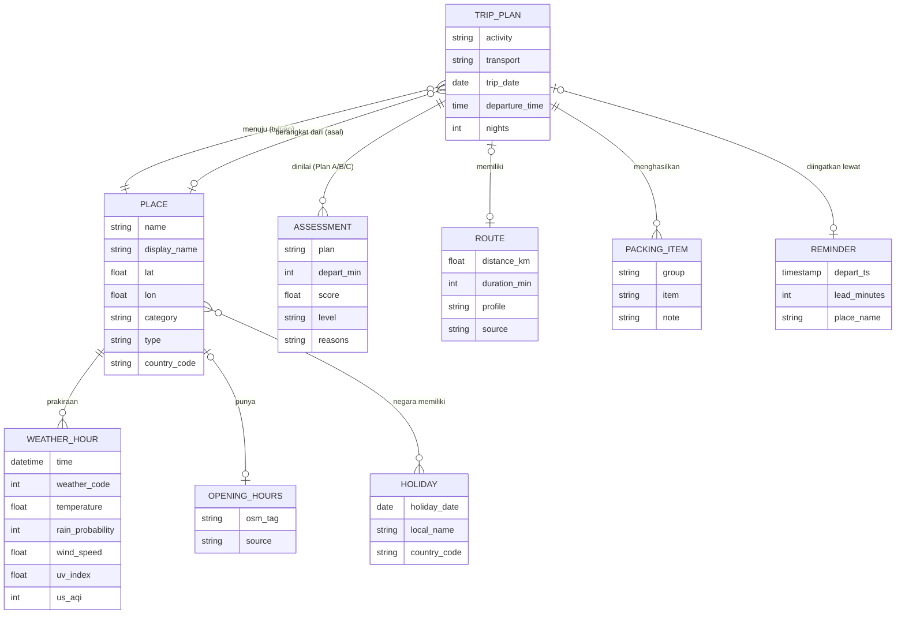

# ERD Konseptual TripReady

TripReady tidak memakai database. Diagram ini adalah **model data konseptual**: entitas yang diolah aplikasi saat membuat rencana. Data diambil dari API publik dan disimpan di memori selama sesi; hanya `REMINDER` yang disimpan, di `localStorage` peramban dan (bila Web Push aktif) di KV Cloudflare.

| Entitas | Sumber | Disimpan di |
|---|---|---|
| PLACE | Photon / Nominatim | Memori (`S.dest`, `S.origin`) |
| TRIP_PLAN | Input form | Memori |
| WEATHER_HOUR | Open-Meteo | Memori |
| ROUTE | OSRM / estimasi | Memori |
| OPENING_HOURS | OpenStreetMap (Overpass) | Memori |
| HOLIDAY | Nager.Date | Memori (cache per negara & tahun) |
| ASSESSMENT | Dihitung `models/assessment.js` | Memori |
| PACKING_ITEM | Dihitung `models/packing.js` | Memori |
| REMINDER | Pilihan pengguna | `localStorage` (`tr_reminder`) + Worker KV (bila Web Push aktif) |

*Catatan:* nama atribut disederhanakan dari objek di kode agar mudah dibaca.
