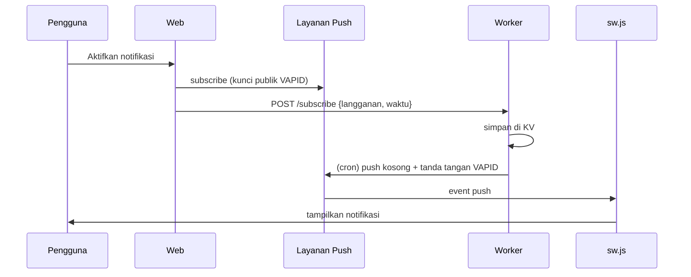

# Web Push TripReady (notifikasi saat web ditutup)

**Cara kerja:** saat pengguna menekan "Aktifkan notifikasi", peramban mendaftar ke layanan push bawaan (mis. FCM di Chrome) dan mengirim alamat langganan + waktu pengingat ke Worker. Worker (cron tiap 2 menit) mengirim *push kosong* bertanda tangan VAPID pada waktunya; `sw.js` yang menampilkan teks notifikasinya. Karena itu tidak perlu enkripsi payload.



## Pemasangan
1. Buat kunci VAPID (F12 → Console di situs HTTPS, tempel):
   ```js
   (async()=>{const k=await crypto.subtle.generateKey({name:"ECDSA",namedCurve:"P-256"},true,["sign","verify"]);const b=u=>btoa(String.fromCharCode(...u)).replace(/\+/g,"-").replace(/\//g,"_").replace(/=+$/,"");console.log("PUBLIC:",b(new Uint8Array(await crypto.subtle.exportKey("raw",k.publicKey))));console.log("PRIVATE:",JSON.stringify(await crypto.subtle.exportKey("jwk",k.privateKey)));})()
   ```
   Simpan PRIVATE secara rahasia; jangan di-commit ke Git.
2. Cloudflare → Workers & Pages → Create Worker `tripready-push` → tempel isi `worker/worker.mjs` → Deploy.
3. Buat KV namespace `REMINDERS` dan pasang sebagai *binding* Worker dengan nama variabel `REMINDERS`.
4. Variables and Secrets: `VAPID_PUBLIC`, `VAPID_PRIVATE_JWK` (secret), `VAPID_SUBJECT` (`mailto:emailmu`), `ALLOWED_ORIGIN` (`https://USERNAME.github.io`, tanpa garis miring di akhir).
5. Triggers → Cron: `*/2 * * * *`.
6. Isi `PUSH_API` (URL Worker) dan `VAPID_PUBLIC` di `js/core/core.js`, commit, push.

## Batasan
Telat hingga ±2 menit (cron); iPhone harus memakai *Tambahkan ke Layar Utama*; batas gratis KV Cloudflare (periksa kuota terbaru); pengguna yang memblokir notifikasi tidak menerima apa pun.
Uji server: `node worker/worker.test.mjs`.
